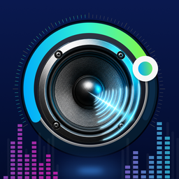
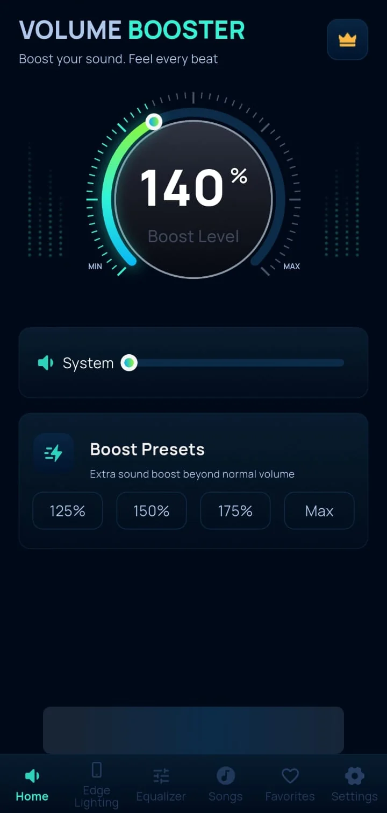
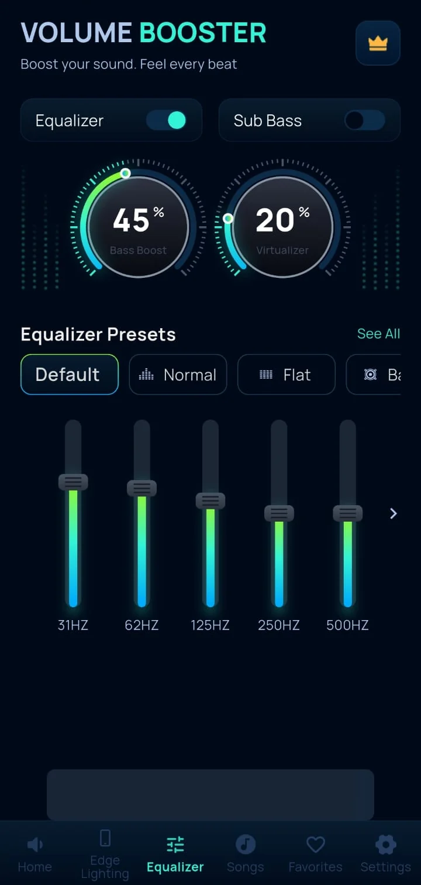
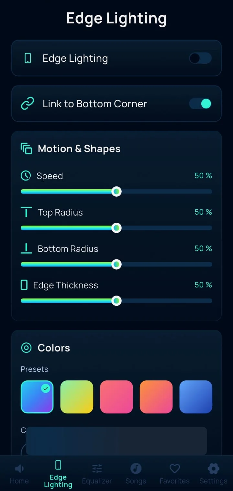
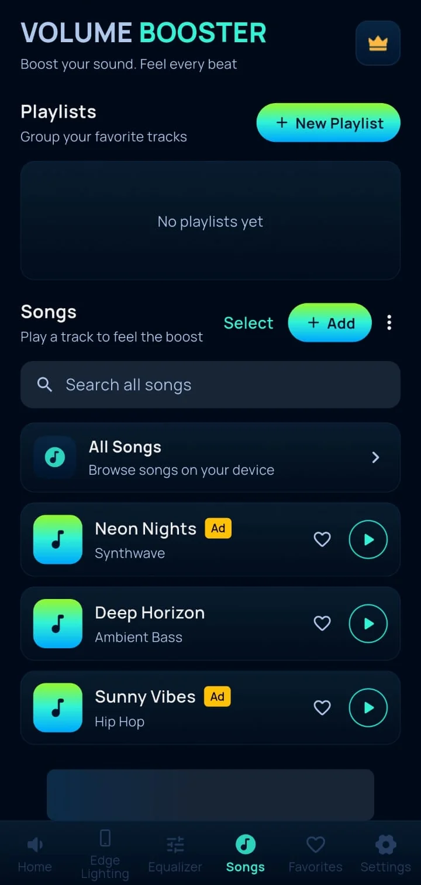
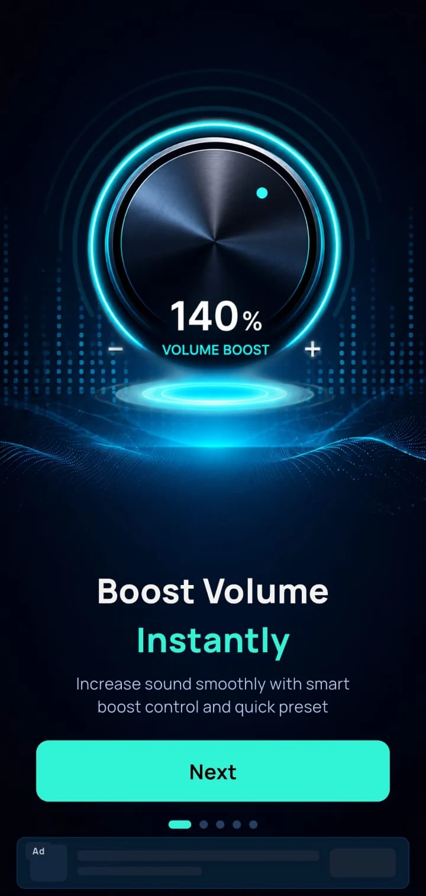
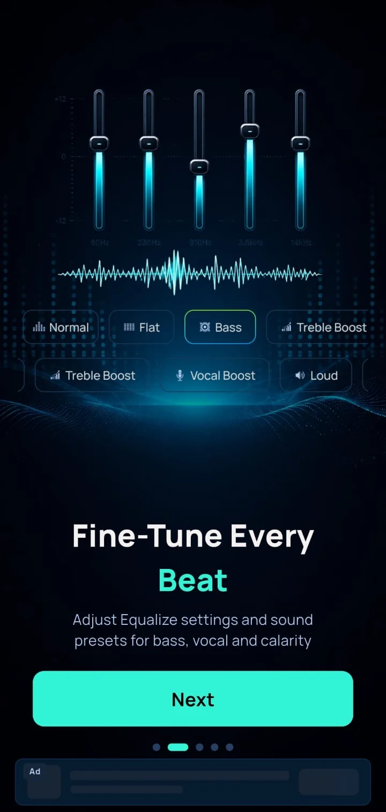
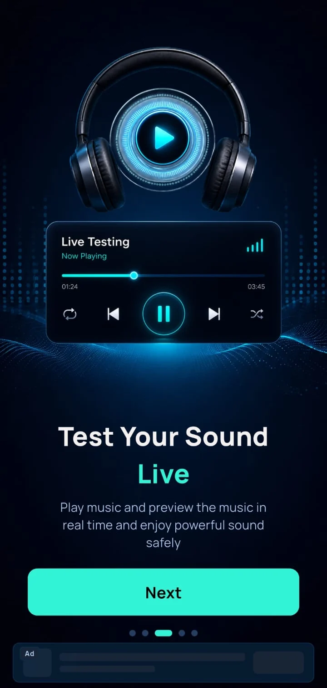
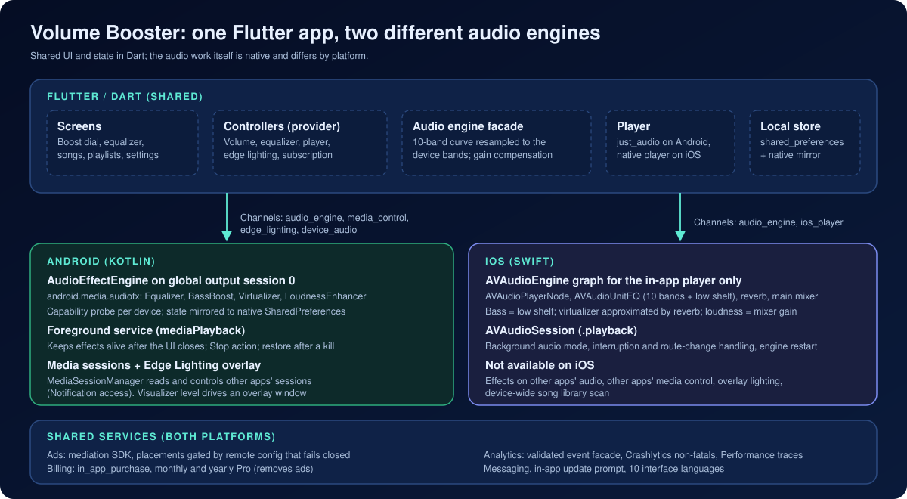
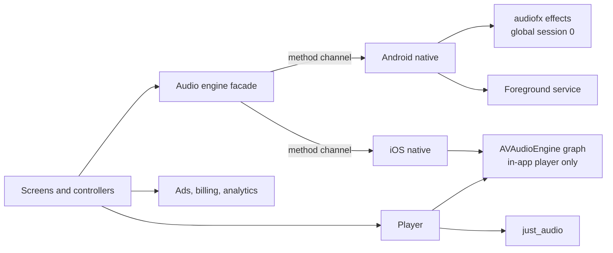

# Volume Booster

**An Android and iOS audio-tuning app: a boost dial, a 10-band equalizer with 20 presets, bass and virtualizer controls, and a built-in music player. On Android the effects are applied through the platform audio-effect engine; on iOS they are applied to the app's own player only.**

**Android · iOS** 
Flutter · Dart · Native Kotlin (android.media.audiofx) · Native Swift (AVAudioEngine)

<table>
  <tr>
    <td></td>
    <td></td>
  </tr>
</table>
Real screenshots from the Android app. The iOS build has no Edge Lighting tab; see the <a href="#android-vs-ios">Android vs iOS</a> table.

---

## Get the App

  
  

## Product at a Glance

| | |
|---|---|
| **What it is** | A boost dial, equalizer, bass and virtualizer controls, and a mini music player, in one dark-themed app |
| **Platforms** | Android 7.0+ and iOS 15+ (Flutter), with separate native audio implementations |
| **Audio on Android** | Equalizer, bass boost, virtualizer and loudness enhancer from `android.media.audiofx`, attached to the global output session and kept alive by a foreground service |
| **Audio on iOS** | An `AVAudioEngine` graph (EQ, reverb, mixer gain) that processes the in-app player only; iOS does not let an app change other apps' audio |
| **Equalizer** | 10-band curve, 20 presets, bass boost and virtualizer knobs, a one-tap Sub Bass mode |
| **Library** | Imported local files, a device-wide song browser (Android), playlists, favourites, queue |
| **Extras** | Edge Lighting overlay driven by the audio level (Android only), vibration intensity, 10 UI languages |
| **Monetisation** | Pro subscription (monthly and yearly, removes ads); mediated ads behind a remote config that fails closed |
| **Code size** | About 27k lines of Dart (excluding generated localisation), about 1.8k lines of Kotlin, about 950 lines of Swift |

## Product Showcase

<table>
  <tr>
    <td align="center"> <b>Edge Lighting</b> Android overlay settings</td>
    <td align="center"> <b>Songs</b> Playlists and library</td>
    <td align="center"> <b>Onboarding</b> Boost</td>
    <td align="center"> <b>Onboarding</b> Equalizer</td>
    <td align="center"> <b>Onboarding</b> Live test player</td>
  </tr>
</table>

The onboarding screens carry the app's own marketing copy. What each control actually does is described in the Android vs iOS table below and in the [technical case study](docs/TECHNICAL_CASE_STUDY.md).

## Key Features

- **Boost dial.** A 100 to 200 percent dial with 125, 150, 175 and Max presets. On Android it sets a target gain on the platform loudness enhancer; on iOS it sets gain on the in-app player's mixer.
- **10-band equalizer.** A fixed 31 Hz to 16 kHz curve that the app resamples onto however many bands the device actually exposes.
- **20 presets.** Bass, Treble Boost, Vocal Boost, Loud, Headphones, Pop, Rock, Hip Hop, Jazz, Classical and more; moving a band switches to Custom.
- **Bass boost, virtualizer and Sub Bass.** Two strength knobs plus a one-tap deep-bass mode that is mutually exclusive with the equalizer.
- **Mini player and Now Playing.** Local playback of imported files, playlists, favourites, queue, shuffle and repeat.
- **Edge Lighting (Android).** A colour glow around the screen, drawn as an overlay and pulsed from the captured output level.
- **External media control (Android).** With Notification access granted, the mini player can read and control another app's playback session.
- **Persistence.** Equalizer, presets and playlists persist locally, and the boost level is restored when Booster Memory is on. Android also mirrors effect state natively so it can be restored without the UI.
- **Ten interface languages**, vibration intensity and optional tap sounds.

## Engineering Highlights

### One effect API, two very different audio stacks
- **Problem:** Android lets an app attach effects to the output mix, while iOS sandboxes every app's audio. A shared UI had to drive both without implying they behave alike.
- **Approach:** the same method-channel contract (`setEqualizerBands`, `setBassBoost`, `setVirtualizer`, `setLoudnessGain`) is implemented twice. Android maps it to `Equalizer`, `BassBoost`, `Virtualizer` and `LoudnessEnhancer`. iOS builds an `AVAudioEngine` graph and maps the same values onto EQ bands, a low shelf, a reverb mix and mixer gain, for the in-app player only. Android-only calls are harmless no-ops on iOS.
- **Outcome:** one set of controllers and screens, with the differences kept in native code and stated openly in the product docs.

### Effects that survive the UI closing (Android)
- **Problem:** effect objects live in the app process, so they vanish when the process dies. Android 12+ also refuses to start a foreground service from the background, and Android 15 refuses it from a boot broadcast.
- **Approach:** a singleton engine owns the effects, a `mediaPlayback` foreground service keeps the process alive with a Stop action, and every change is mirrored to native preferences so a fresh process can rebuild the chain. Promotion to foreground happens in `onStartCommand` and fails softly; the boot receiver skips Android 15 and later and the state restores on next launch instead.
- **Outcome:** a refused service start no longer kills the process, and persisted state is rebuilt instead of lost.

### A 10-band curve on hardware with about five bands
- **Problem:** the UI shows ten bands, but the Android equalizer reports its own band count and centre frequencies, and presets that differ by small amounts become indistinguishable.
- **Approach:** the curve is interpolated in log-frequency space onto the device's reported centres, preset gains were widened so characters survive the coarser bands, and an automatic gain compensation offsets the headroom the effects consume, capped by a total gain limit.
- **Outcome:** presets stay distinguishable on devices with fewer bands, and every effect is probed first and reported as unavailable instead of crashing on devices without the effect engine.

### Ad config that fails closed
- **Problem:** ads must be switchable per placement without a release, and must never appear because a config fetch failed.
- **Approach:** placements are read from a remote document; until a read has succeeded, and unless a placement's flag is literally `true`, nothing is shown. A global kill switch and live updates apply without a restart. A Pro entitlement turns every ad format off.
- **Outcome:** offline or failed config means no ads, not default-on ads.

More: [docs/ENGINEERING_CHALLENGES.md](docs/ENGINEERING_CHALLENGES.md).

## Android vs iOS

The two builds share the UI but not the audio behaviour. This table lists what the production code does on each platform.

| Capability | Android | iOS |
|---|---|---|
| What audio is processed | Attached to the global output session (session 0). Whether another app's output is affected depends on the device, Android version and OEM audio stack; the app's own player is the dependable path | The in-app player only. iOS does not allow effects on other apps' audio, and the app does not attempt it |
| Equalizer | Platform `Equalizer`; band count and range come from the device | `AVAudioUnitEQ`: 10 parametric bands, shown range of plus or minus 15 dB |
| Bass boost | Platform `BassBoost`, strength 0 to 1000 | Low-shelf filter at 90 Hz, up to 12 dB |
| Virtualizer | Platform `Virtualizer`, strength 0 to 1000 | Approximated with a room reverb, up to 60 percent wet |
| Boost dial (100 to 200 percent) | Maps linearly to a `LoudnessEnhancer` target gain of 0 to 2000 mB (plus compensation, total capped at 3000 mB) | Maps to mixer output volume 1.0 to 2.0 on the in-app player; code comments note it can clip at the top |
| Limiter or normalisation | None in app code beyond the gain cap | None in app code |
| Capability probing | Each effect is created briefly and reported as available or not | Reports all effects as available |
| Background behaviour | `mediaPlayback` foreground service with a persistent notification and Stop action; restored from saved state | Background audio mode with a `.playback` session; engine restarted on foreground, route change and interruption end |
| Interruptions and audio focus | No custom audio-focus code; relies on the player plugin | Interruption began and ended are handled; playback resumes if it was playing |
| Headphones and Bluetooth | No device-specific handling beyond the OS output route | Route changes trigger an engine liveness check only |
| Media controls | Persistent service notification; no lock-screen transport controls from the app's own player | No lock-screen or Control Center transport controls |
| Other apps' playback | Read and control via media sessions, after the user grants Notification access | Not possible |
| Song library | Imported files plus a MediaStore scan of the device | Imported files only (file picker) |
| Visualizer | Output-level capture drives Edge Lighting (needs microphone permission) | Not available; the in-app waveform is a drawn animation |
| Edge Lighting overlay | Yes (draw-over-apps permission) | Not offered; the tab is hidden |
| Billing | Play Billing through `in_app_purchase` | StoreKit through `in_app_purchase` |
| Tracking consent | Not applicable | App Tracking Transparency prompt before ads and analytics |
| Update prompt | Play in-app update API | Store version lookup and link |

None of the above is a claim about hearing, speaker hardware output or a safe maximum volume. The app adjusts digital gain and filtering; it does not raise what a speaker is physically able to produce.

## Architecture

  

Details: [docs/ARCHITECTURE.md](docs/ARCHITECTURE.md).

## Technology Stack

| Layer | Technology |
|---|---|
| App | Flutter / Dart 3, `provider`, generated localisation (10 languages) |
| Android audio | Kotlin, `android.media.audiofx` (Equalizer, BassBoost, Virtualizer, LoudnessEnhancer, Visualizer), foreground service, `MediaSessionManager` |
| iOS audio | Swift, `AVAudioEngine`, `AVAudioUnitEQ`, `AVAudioUnitReverb`, `AVAudioSession` |
| Playback | `just_audio` (Android), native player (iOS), `file_picker` |
| Storage | `shared_preferences`, native `SharedPreferences` mirror (Android) |
| Backend | Firebase: Firestore (remote ad flags), Analytics, Crashlytics, Performance, Messaging |
| Ads | AdMost mediation SDK, local plugin fork that adds banner preloading |
| Billing | `in_app_purchase` (Play Billing and StoreKit) |
| Native extras | Kotlin overlay service, notification-listener service, boot receiver; Swift ATT bridge |
| Testing | `flutter_test`: six test files, 25 test cases |
| Tooling | R8 shrinking, launcher-icon and native-splash generators |

## Documentation

| Read | For |
|---|---|
| [Technical case study](docs/TECHNICAL_CASE_STUDY.md) | How the audio and platform layers work, end to end |
| [Architecture](docs/ARCHITECTURE.md) | Layers, channels, flows and diagrams |
| [Engineering challenges](docs/ENGINEERING_CHALLENGES.md) | Problem, context, approach, trade-offs, outcome |
| [Product overview](docs/PRODUCT_OVERVIEW.md) | Features, screens and platform differences |
| [Privacy and source](docs/PRIVACY_AND_SOURCE.md) | What is and is not published |

## Source Code

This repository is a portfolio showcase for a production application. Production source code is maintained privately. See [RIGHTS.md](RIGHTS.md) for usage terms.
