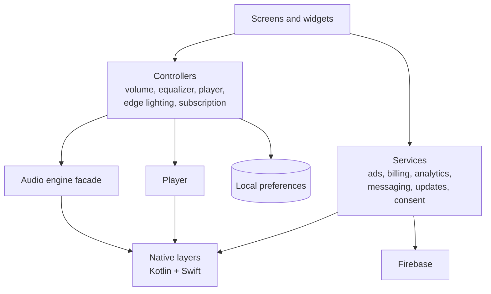
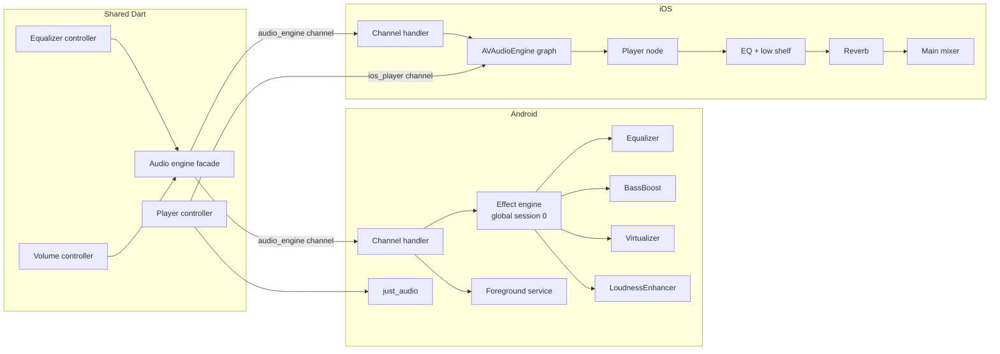
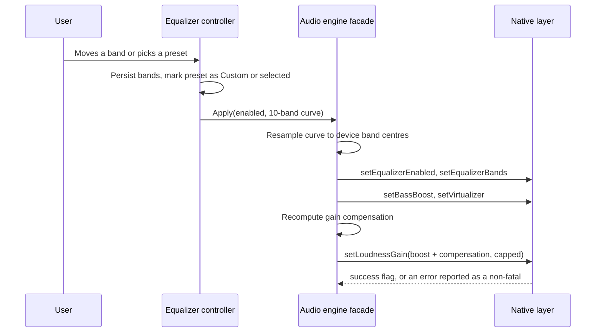
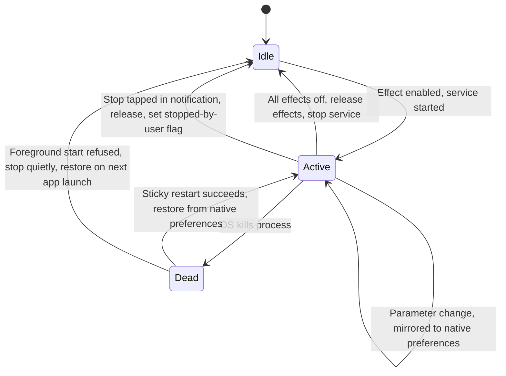
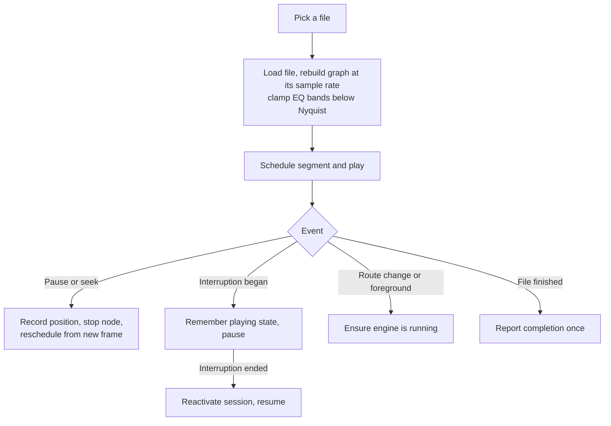
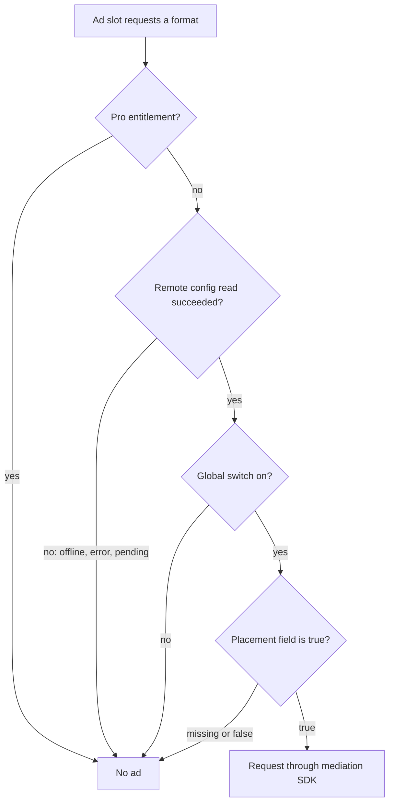

# Architecture

All diagrams are original and conceptual. They describe responsibilities, not production class or file names.

## 1. Layers

Screens never talk to a native API or an SDK directly. Controllers hold state and persist it; the audio facade and the services are the only code that crosses into native layers or the network.

## 2. Platform abstraction

The shared code sees one contract. Each platform implements it differently.

Points to note:
- The channel handlers answer the same method names. Android-only methods (the "stopped by user" flags) are no-ops on iOS.
- The capability reply has the same shape on both platforms, so Dart does not branch on platform to decide which controls to show.
- Playback is the one place the platforms diverge in Dart: `just_audio` on Android, a native player behind a second channel on iOS, because only an engine graph can host the iOS EQ.

## 3. Applying an equalizer change

## 4. Android effect lifetime

## 5. iOS player lifecycle

## 6. Ad gating

The remote document is watched live, so flipping a flag takes effect in a running session.

## 7. Cross-cutting

- **Failure reporting.** Every audio, media and overlay channel call reports its failure as a tagged non-fatal; the polled call is rate-limited.
- **Persistence.** Dart state lives in `shared_preferences`. Android additionally keeps a native copy of effect state, because the service may run when Flutter does not.
- **Consent.** On iOS, App Tracking Transparency resolves before ads and analytics start; on Android the step is skipped.
